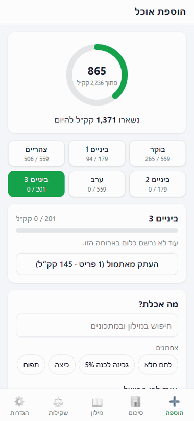
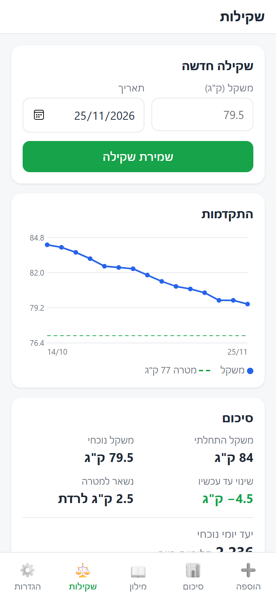
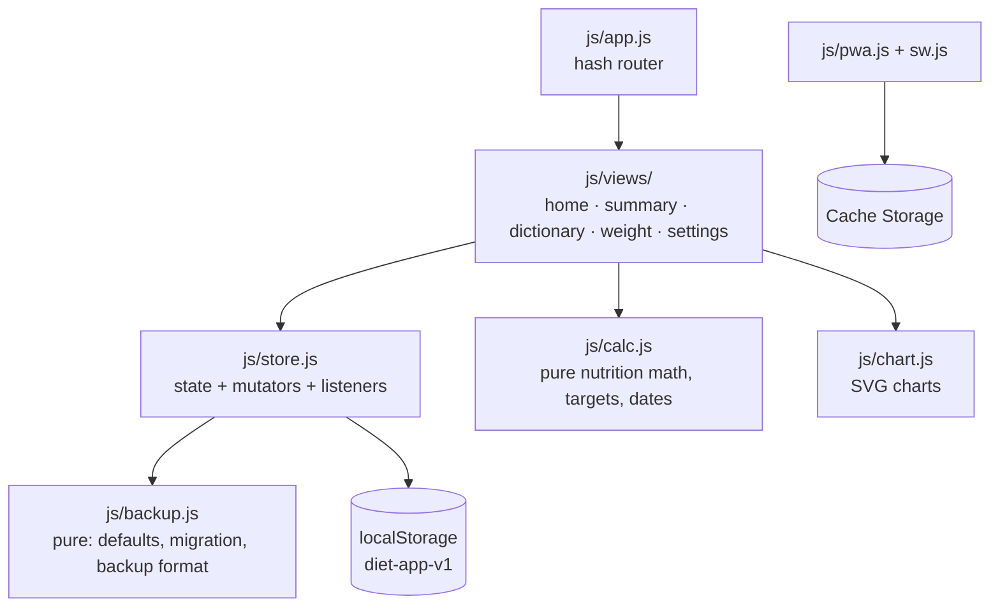

# Diet Tracker PWA

[](https://github.com/roeiraz12/diet-tracker-pwa/actions/workflows/ci.yml)
[](LICENSE)

A small, private food and weight diary for the phone. You build your own dictionary of foods and recipes,
log what you eat per meal, and see how many calories are left today against a target computed from your
profile and goal. No server, no account, no tracking: everything stays in your browser.

**[▶ Try it live](https://roeiraz12.github.io/diet-tracker-pwa/)** (Hebrew UI; your data stays in your browser's
`localStorage` and is never sent anywhere)

<p align="center">
  
</p>

> The app gives general estimates only and is not medical advice.

## Case study

### Problem

Mainstream calorie apps want an account, push a subscription, show ads, and upload your eating habits and weight
to someone else's server. Their huge shared food databases are also noisy: the same item appears with many
different values, while most people eat the same few dozen foods anyway. I wanted something closer to a paper
notebook: fast to log, honest about the numbers, and private by default.

### Users

Hebrew-speaking adults who want to lose, gain or keep their weight with a simple daily calorie budget, mostly on a
phone, often with a fairly repetitive menu. The UI is fully right-to-left Hebrew.

### My role

I designed and built it end-to-end: product scope, UX for a one-handed phone flow, the data model and migrations,
the nutrition and target math, the hand-drawn SVG charts, the offline service worker, tests, CI and deployment.

### Key decisions

- **Local-only, privacy first.** All data lives in one versioned object in `localStorage`. There is no backend to
  breach, no account to create, and nothing to host beyond static files.
- **No backend, no build step.** Plain ES modules, HTML and CSS. The repo root *is* the deployable site, which keeps
  it easy to host on GitHub Pages and easy to read.
- **Installable PWA that works offline.** A versioned service worker caches the app shell (cache-first in
  production, network-first on localhost). New versions wait for the user: an "update available" banner applies
  them, so an open screen is never swapped out mid-entry.
- **Backup and restore instead of sync.** Since data never leaves the device, losing the phone would mean losing
  the diary. The app exports a JSON backup (share sheet on iPhone, download elsewhere), validates files on import,
  and shows a weekly reminder until a fresh backup is saved. It also asks the browser for persistent storage.
- **Calorie target from the Mifflin-St Jeor equation.** BMR (Mifflin-St Jeor) × activity factor gives maintenance
  calories; the gap to the goal weight is spread over the days left to the goal date (7,700 kcal per kg). Unsafe
  paces trigger warnings and a suggested realistic date, and the target never drops below a safe minimum
  (1,200 / 1,500 kcal). A manual target can override it.
- **Personal dictionary with snapshots.** Foods store values per 100 g plus an optional named serving (slice, cup,
  unit). Recipes are always computed live from their ingredients, but each log entry stores a nutrition snapshot,
  so editing a food later never rewrites past days.
- **A "diet day" that starts at 04:00.** A late-night snack after midnight still counts toward the evening it
  belongs to.

### Challenges

- **Right-to-left UI with left-to-right data.** Text, layout and navigation are RTL, but time axes and numbers read
  left to right. Charts render in an explicit `dir="ltr"` container and numbers are bidi-isolated.
- **Hebrew search.** Matching "לחם" with "לֶחֶם", final letters (ם / מ) and punctuation like ׳ and ״ needed a small
  normalizer, used for both search and duplicate detection.
- **Safe defaults for weight-loss math.** A naive formula happily produces dangerously low targets for an aggressive
  goal date. The target logic caps the pace, explains why, and suggests a realistic date instead.
- **Service worker updates without data loss.** Cache versioning, a skip-waiting handshake, and a reload only after
  the user taps "update".
- **Testable code without a framework.** The pure logic (`js/calc.js`, `js/backup.js`) has no DOM or storage
  access, so the same files run in the browser and under Node's built-in test runner.

### Outcome

A complete, installable app: logging a meal takes a few taps, the remaining-calories ring and per-meal budgets
answer "can I still eat this?" at a glance, and the weight chart shows the trend against the goal line. It runs
fully offline, deploys as static files, and the core math is covered by unit tests that run on every push.

### Roadmap

- Barcode scanning to prefill a new food from a public product database (opt-in, still no account).
- Optional end-to-end encrypted sync between devices, keeping local-only as the default.
- Weekly averages and streaks on the summary screen.
- English UI alongside Hebrew.

## Screenshots

| Add food | Daily summary | Weight |
|---|---|---|
|  |  |  |
| Calories left today, per-meal budgets, and search across the personal dictionary. | Calories and protein / carbs / fat against targets, per meal, browsable by date. | Weigh-ins and progress against the goal line on a hand-drawn SVG chart. |

## Features

- **Personal food dictionary.** Foods with calories and optional macros per 100 g, plus a named serving.
  Recipes are built from foods.
- **Meal log.** Six meals a day with a per-meal calorie budget; copy a meal from yesterday in one tap.
- **Daily target.** Balanced, low-carb or keto macro split, or a manual override.
- **Daily summary.** Calories and macros against targets, browsable by date.
- **Weight tracking.** Weigh-ins with a progress chart and a goal line.
- **Backups.** Export and restore a JSON backup, with a weekly reminder.
- **PWA.** Installable, works offline, "update available" banner on new deploys.

## Tech stack

| Layer | Tools |
|---|---|
| UI | Vanilla JavaScript ES modules, HTML, CSS (no framework, no build step) |
| Storage | `localStorage`, single versioned state object with migrations |
| Offline | Service worker (`sw.js`) with versioned cache, Web App Manifest |
| Charts | Custom SVG charts (`js/chart.js`) |
| Tests / CI | `node:test` (no dependencies), GitHub Actions |
| Hosting | GitHub Pages |

## Architecture



| Path | What |
|---|---|
| `index.html` | Shell and bottom navigation |
| `js/store.js` | Single source of truth: load, migrate, save, subscribe |
| `js/calc.js` | Pure functions: BMR, targets, macros, meal budgets, parsing, dates |
| `js/backup.js` | Pure functions: default state, schema migration, backup build / validation, reminder |
| `js/views/` | One module per screen |
| `js/banners.js`, `js/pwa.js`, `sw.js` | Install tip, backup reminder, update banner, offline cache |
| `test/` | Unit tests for `calc.js` and `backup.js` |
| `docs/GUIDE-HE.md` | End-user guide in Hebrew (install, publish, backup, update) |

## Run locally

Any static server works, for example:

```bash
python -m http.server 8000
# or: npx http-server -p 8000
```

Then open http://localhost:8000. Opening `index.html` directly from disk does not work (ES modules need http).

## Tests

```bash
npm test   # node --test, Node 20+, nothing to install
```

## Deploy

It is a static site served by GitHub Pages from `main` / root. When you ship changes to cached files, bump
`VERSION` in `sw.js` so installed copies pick up the new version.

## בעברית

<div dir="rtl">

אפליקציית PWA פשוטה לטלפון למעקב אחרי מה שאוכלים ואחרי המשקל: מילון מאכלים ומתכונים אישי, רישום לפי ארוחות עם יתרת קלוריות להיום, יעד קלורי שמחושב לפי גיל, גובה, משקל, פעילות ומטרה, גרף שקילות, וגיבוי לקובץ. הכל נשמר רק בטלפון, בלי שרת ובלי הרשמה. מדריך שימוש מלא בעברית נמצא ב-[docs/GUIDE-HE.md](docs/GUIDE-HE.md).

</div>

## License

[MIT](LICENSE)
