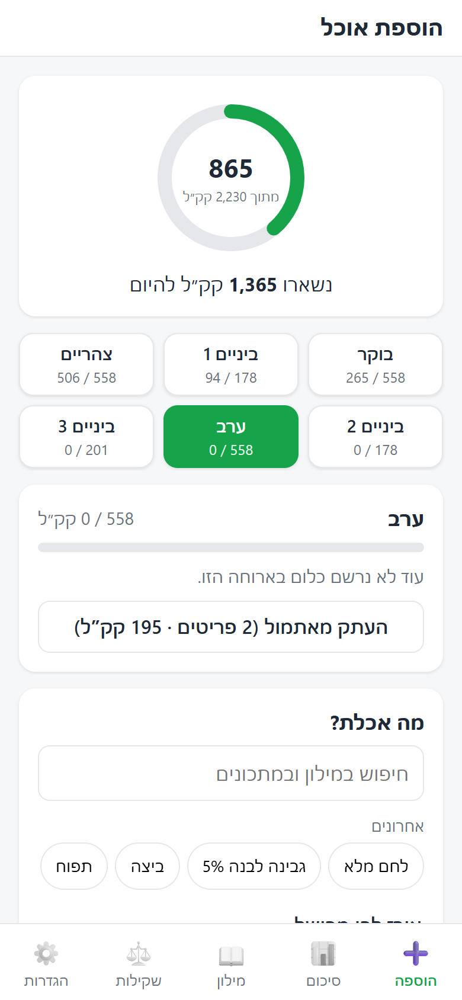
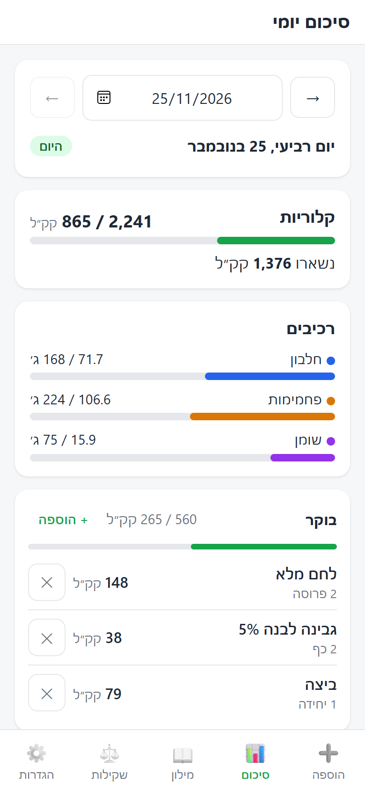
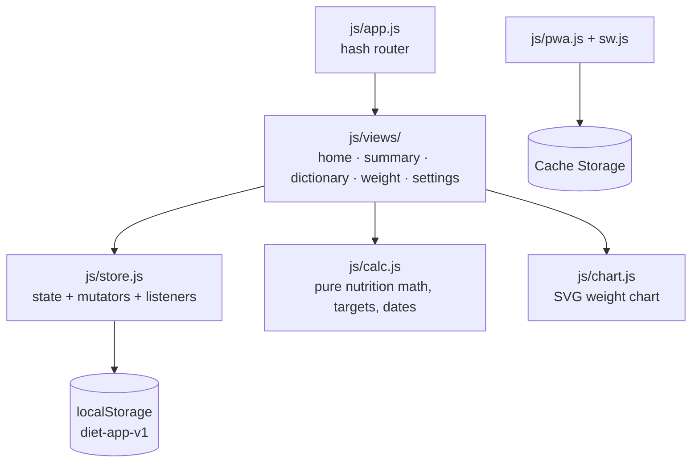

<div dir="rtl">

## יומן דיאטה

אפליקציית PWA פשוטה לטלפון למעקב אחרי מה שאוכלים ואחרי המשקל: מילון מאכלים ומתכונים אישי, רישום לפי ארוחות עם יתרת קלוריות להיום, יעד קלורי שמחושב לפי גיל, גובה, משקל, פעילות ומטרה, גרף שקילות, וגיבוי לקובץ. הכל נשמר רק בטלפון, בלי שרת ובלי הרשמה. מדריך שימוש מלא בעברית נמצא ב-[docs/GUIDE-HE.md](docs/GUIDE-HE.md).

</div>

---

# Diet Tracker PWA

A small, private food and weight diary for the phone. You build your own dictionary of foods and recipes,
log what you eat per meal, and see how many calories are left for today against a daily target computed
from your profile and goal. There is no server, no account and no tracking: all data lives in the browser's
`localStorage` on your device.

> The app gives general estimates only and is not medical advice.

## Screenshots

| Add food | Daily summary | Weight |
|---|---|---|
|  |  |  |

## Features

- **Personal food dictionary.** Foods with calories and optional macros per 100 g, plus a named serving
  (slice, cup, unit). Recipes are built from foods and always computed live from them.
- **Meal log.** Six meals a day with a per-meal calorie budget; copy a meal from yesterday in one tap.
  Entries snapshot their nutrition, so editing a food later does not rewrite history.
- **Daily target.** BMR × activity level, adjusted to reach the goal weight by the goal date
  (balanced, low-carb or keto macro split), or a manual override.
- **Daily summary.** Calories and protein / carbs / fat against targets, browsable by date.
- **Weight tracking.** Weigh-ins with a progress chart (hand-drawn SVG) and a goal line.
- **Backups.** Export and restore a JSON backup; a weekly reminder nudges you to save one.
- **PWA.** Installable, works offline, shows an "update available" banner when a new version is deployed.

## Tech stack

| Layer | Tools |
|---|---|
| UI | Vanilla JavaScript ES modules, HTML, CSS (no framework, no build step) |
| Storage | `localStorage`, single versioned state object with migrations |
| Offline | Service worker (`sw.js`) with versioned cache, Web App Manifest |
| Charts | Custom SVG line chart (`js/chart.js`) |

## Architecture



| Path | What |
|---|---|
| `index.html` | Shell and bottom navigation |
| `js/store.js` | Single source of truth: load, migrate, save, subscribe |
| `js/calc.js` | Pure functions: BMR, targets, macros, meal budgets, parsing |
| `js/views/` | One module per screen |
| `js/banners.js`, `js/pwa.js`, `sw.js` | Install tip, backup reminder, update banner, offline cache |
| `docs/GUIDE-HE.md` | End-user guide in Hebrew (install, publish, backup, update) |

## Run locally

Any static server works, for example:

```bash
python -m http.server 8000
# or: npx http-server -p 8000
```

Then open http://localhost:8000. Opening `index.html` directly from disk does not work (ES modules need http).

## Deploy

It is a static site: GitHub Pages (Settings → Pages → deploy from `main` / root) or Netlify Drop both work.
When you ship changes, bump `VERSION` in `sw.js` so installed copies pick up the new version.

## License

[MIT](LICENSE)
